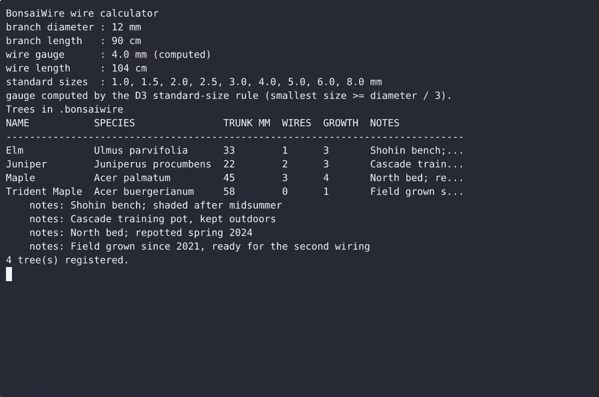
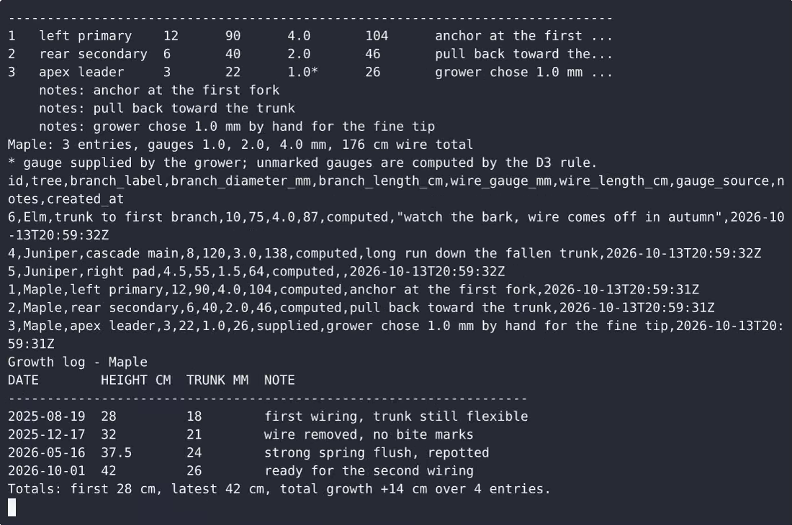

# BonsaiWire — complete Full-stack app command-line tool example app

Want to run your own command-line tool without paying for SaaS? **BonsaiWire** is a free, Apache-2.0-licensed Full-stack app project that you can clone and self-host today. BonsaiWire is a single-file Python command-line tool for people who wire and grow bonsai: it works out which metric wire gauge and how much wire a branch needs from a diameter and length measurement, keeps a per-tree…. Every BonsaiWire feature — every screen, every seed record — is here. [Open BonsaiWire on cenius.ai](https://cenius.ai/marketplace/p/bonsaiwire?ref=gh&utm_campaign=bonsaiwire-webapp) to modify it without writing code.


[](LICENSE)  [](https://cenius.ai)

[](https://cenius.ai/marketplace/p/bonsaiwire?ref=gh&utm_campaign=bonsaiwire-webapp)

> **▶ [Open & edit in cenius.ai](https://cenius.ai/marketplace/p/bonsaiwire?ref=gh&utm_campaign=bonsaiwire-webapp)** — one click to an editable workspace: describe changes in plain English, get an instant preview, one-click deploy and host. Modifications made on the platform come with full rebrand & relicense rights.

_Local clone? See [Quick start](#quick-start) below. cenius.ai is the zero-setup path._

## Demo


📽 **[Watch the walkthrough](https://cenius.ai/marketplace/p/bonsaiwire?ref=gh&utm_campaign=bonsaiwire-webapp)** — plays on cenius.ai · [MP4 file](.github/media/demo.mp4)

## Screenshots

 

## Features

- Bonsai branch wiring schedule
- Wire gauge and length calculator
- Tree growth progress log
- Tree registry

## Architecture

Folder layout: `tests/`. Starting up is just `./install.sh`: it installs what is needed and pre-fills the database so you have data to work with straight away. Built in Full-stack app (19 files). Installation walkthrough: [`INSTALL.md`](INSTALL.md).

## Quick start

```bash
./install.sh   # installs dependencies + seeds demo data
```

See [`INSTALL.md`](INSTALL.md) for full setup and usage instructions.

## Usage guide

Every example below uses a scratch store so you can paste them in order without
touching your own data:

```bash
export DATA=./.bonsaiwire-usage        # any directory
export BONSAIWIRE_PASSPHRASE=cenius    # passphrase for the write commands
```

### 1. Set up the local grower profile

Write commands (`tree add`, `schedule add`, `schedule remove`, `log add`) are
locked behind one local profile. The passphrase is never stored - only a random
salt and a PBKDF2-HMAC-SHA256 digest.

```bash
python3 bonsaiwire.py --data-dir "$DATA" profile setup --owner cenius
python3 bonsaiwire.py --data-dir "$DATA" profile status
```

```
Grower profile
owner           : cenius
passphrase      : set (salted PBKDF2-HMAC-SHA256 hash, 200000 iterations)
created         : 2026-04-18T09:12:44Z
data directory  : ./.bonsaiwire-usage
write commands read BONSAIWIRE_PASSPHRASE or prompt for the passphrase.
```

With no profile yet, every write command prints

```
$ python3 bonsaiwire.py tree add --name Maple --trunk-diameter-mm 45
bonsaiwire: no grower profile set up; run: bonsaiwire profile setup
```

and exits `1` leaving the store untouched. A wrong passphrase prints
`passphrase did not match` and exits `1` the same way.

### 2. Register trees

```bash
python3 bonsaiwire.py --data-dir "$DATA" tree add \
  --name Maple --species 'Acer palmatum' --trunk-diameter-mm 45 --notes 'north bed'
python3 bonsaiwire.py --data-dir "$DATA" tree add \
  --name Juniper --species 'Juniperus procumbens' --trunk-diameter-mm 22
python3 bonsaiwire.py --data-dir "$DATA" tree list
```

_Full guide: [`USAGE.md`](USAGE.md)_

## FAQ

### How do I get BonsaiWire running locally?

Clone this repository and run `./install.sh`, then start the app as described in [`INSTALL.md`](INSTALL.md). BonsaiWire is fully self-hostable — no external services are required to try it.

### What powers BonsaiWire under the hood?

Powered by Full-stack app. This repo is the real thing — full source, seed data, and all — ready to clone and start up. Highlights include tree registry.

### Can I remove the BonsaiWire name and use my own?

Yes — and the easiest way is [remixing it on cenius.ai](https://cenius.ai/marketplace/p/bonsaiwire?ref=gh&utm_campaign=bonsaiwire-webapp): modifications made on the platform come with full rebrand and relicense rights over your derivative.

### Is it OK to ship BonsaiWire as part of a product?

The code is under the Apache-2.0 license, which allows commercial use without restriction. You can build, sell, and deploy it freely. Full text: [LICENSE](LICENSE).

### Is BonsaiWire editable without a developer?

Open it on [cenius.ai](https://cenius.ai/marketplace/p/bonsaiwire?ref=gh&utm_campaign=bonsaiwire-webapp) and describe the changes you want in plain English — the platform modifies the app and gives you a new, downloadable build.

## License & rebranding

Released under the [Apache License 2.0](LICENSE) (© 2026 Cenius AI) — free for personal and commercial use. The Cenius name/logo are trademarks (see NOTICE).

**Need a customized version?** [Remix this app on cenius.ai](https://cenius.ai/marketplace/p/bonsaiwire?ref=gh&utm_campaign=bonsaiwire-webapp) — modifications made on the platform come with **full rebrand & relicense rights** over your derivative.

## Built with cenius.ai

This entire application — code, design, seeded demo data — was generated on **[cenius.ai](https://cenius.ai)** from a plain-English description.

- 🚀 [Build your own app on cenius.ai](https://cenius.ai)
- 🎛️ [Remix BonsaiWire on the marketplace](https://cenius.ai/marketplace/p/bonsaiwire?ref=gh&utm_campaign=bonsaiwire-webapp) — open it in a workspace, prompt for changes, and ship your own version.

More open-source apps: [the Cenius-ai catalog](https://github.com/Cenius-ai) · [showcase index](https://github.com/Cenius-ai/showcase)
